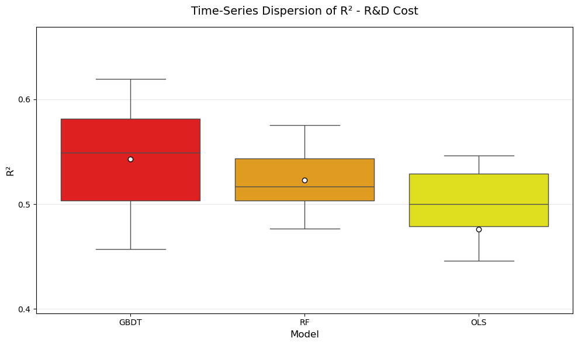
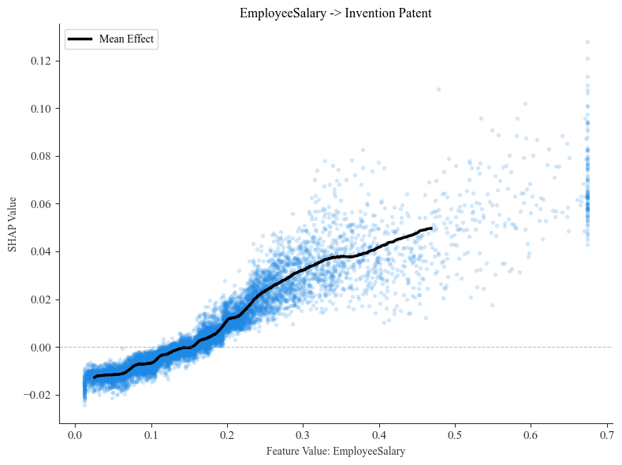
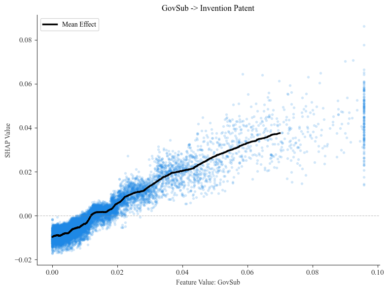
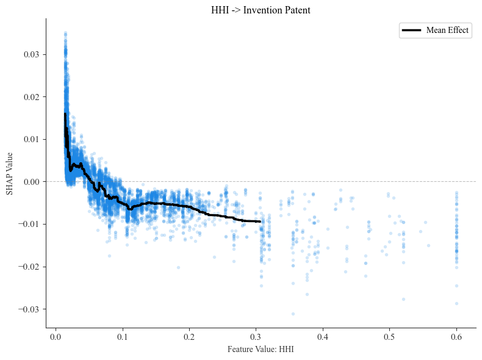

# Research overview

## Objective

Identify which groups of corporate and stakeholder characteristics are most useful for predicting future innovation inputs and outputs, including R&D intensity and patent-related measures.

## Workflow

1. Review literature and operationalize firm, management, employee, governance, market and institutional variables.
2. Prepare and merge firm-year information with Stata and Python.
3. Compare tree-based models with an OLS baseline using later-year test samples.
4. Interpret model predictions using SHAP and visualizations.

## Reading the materials

The thesis is the primary long-form research document. The notebook, scripts and saved figures are working artifacts from the broader project and may correspond to different versions. Predictor counts and sample sizes should be interpreted within the specific artifact, target and filtering rules. Selected figures below come from saved notebook outputs, not a new execution or an assertion that they match the thesis tables exactly.

## Selected saved figures

